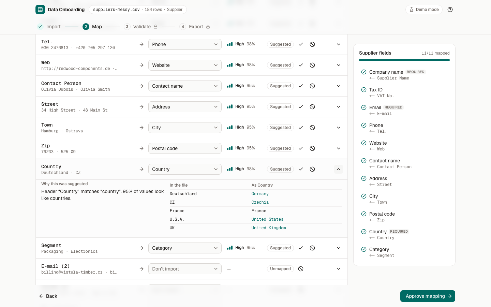

# Data Onboarding

Import, map, validate and export supplier data from messy CSV and Excel files.
**An AI model suggests how columns map to fields, a person approves, and deterministic code does everything else.**



Supplier lists arrive as spreadsheets that never match the target system: `E-mail` vs `Kontakt`, `UK` vs `GBR`, `acme.com` without `https://`, the same company twice, a cell that Excel would run as a formula. This app takes such a file through four steps:

| Step         | What happens                                                                                                                                                                                           |
| ------------ | ------------------------------------------------------------------------------------------------------------------------------------------------------------------------------------------------------ |
| **Import**   | CSV or XLSX is parsed in the browser. Duplicate and empty headers are fixed and reported. Nothing is uploaded.                                                                                         |
| **Map**      | Each column gets a suggested target field, a confidence bucket and a one-line reason. You accept, change or ignore. The server re-checks the mapping and sends it back if a required field is missing. |
| **Validate** | Rules clean and check every value. Safe changes are applied and marked; meaning-changing ones are offered as one-click fixes. Edit cells, exclude rows, review possible duplicates.                    |
| **Export**   | CSV in schema order, formula-injection safe, plus a JSON audit report of every decision, change, open issue and excluded row.                                                                          |

There is a **“Try with sample data”** button: 184 deliberately messy suppliers.

## How the AI is used (and where it is not)

- The model sees a **column profile**, not your data: header text plus statistics such as “97% of values look like email addresses”. Up to 3 example values per column are sent only if you switch on sample sharing.
- It returns structured output validated with Zod. Unknown columns or fields, duplicate targets and out-of-range confidence are repaired by domain rules; unusable output is retried once with the validation errors, then replaced by heuristics, and the UI says so.
- Confidence is shown as High / Medium / Low and labelled as a model estimate, not a calibrated probability.
- Nothing the model says is applied until you approve. Transformations and validation are plain TypeScript with table-driven tests.
- **Without an API key the app runs in demo mode**: deterministic heuristics (synonyms, typo-tolerant matching, value patterns) produce the suggestions, and the header shows “Demo mode”.

The workflow is a LangGraph state graph with a retry loop, a fallback, a human-review interrupt and a re-review loop. It runs on Vercel without a database: threads live in a bounded `MemorySaver`, and a request that lands on a cold instance rebuilds the thread from what the browser echoes back. See [ADR 0002](docs/adr/0002-langgraph-memorysaver-rehydration.md).

## Getting started

Requirements: Node 22+, pnpm 10.

```bash
pnpm install
```

```bash
pnpm dev
```

Open http://localhost:3000 and click **Try with sample data**.

To use a real model, copy `.env.example` to `.env.local` and set `OPENROUTER_API_KEY`. `OPENROUTER_MODEL` defaults to `anthropic/claude-haiku-5.5`; any OpenRouter model with structured-output support works.

### Scripts

| Command                             | What it does                                                        |
| ----------------------------------- | ------------------------------------------------------------------- |
| `pnpm dev`                          | Development server                                                  |
| `pnpm build` / `pnpm start`         | Production build / server                                           |
| `pnpm typecheck`                    | Route types + `tsc --noEmit`                                        |
| `pnpm lint`                         | ESLint (Next, TypeScript, hooks, a11y)                              |
| `pnpm format` / `pnpm format:check` | Prettier with Tailwind class sorting                                |
| `pnpm test`                         | Unit, integration and component tests (Vitest)                      |
| `pnpm e2e`                          | Playwright against a production build in demo mode, with axe checks |
| `pnpm screenshots`                  | Captures every step at 1440 px and 390 px into `docs/screenshots/`  |
| `pnpm generate:sample`              | Regenerates the seeded sample CSV and the XLSX test fixture         |

## Architecture

```
src/
  domain/          dataset · schema · mapping · quality · export   pure TypeScript + Zod, no frameworks
  contracts/       Zod schemas for the /api/mapping/* wire format, shared by server and browser
  infrastructure/  parsers (CSV, XLSX) · exporters (CSV) · ai (server-only: OpenRouter, LangGraph)
  application/     Zustand workflow store, pure transitions, memoized selectors, API client
  features/        import · mapping · validation · export
  components/      shadcn/ui · app shell, stepper, sticky footer, route guard · shared table
  app/             Next.js routes; app/api/mapping/* is the only consumer of infrastructure/ai
```

Details: [docs/architecture.md](docs/architecture.md). Decisions:

- [ADR 0001](docs/adr/0001-client-side-parsing.md) Parse files in the browser
- [ADR 0002](docs/adr/0002-langgraph-memorysaver-rehydration.md) LangGraph with MemorySaver and client-driven rehydration
- [ADR 0003](docs/adr/0003-ai-suggests-deterministic-executes.md) AI suggests, a person approves, deterministic code executes
- [ADR 0004](docs/adr/0004-zustand-and-derived-state.md) Zustand for source state, everything else derived
- [ADR 0005](docs/adr/0005-read-excel-file.md) read-excel-file for XLSX

**Stack:** Next.js 16 (App Router, Cache Components) · React 19 · TypeScript 6 (strict, `noUncheckedIndexedAccess`) · Tailwind CSS 4 · shadcn/ui on Radix · TanStack Table 9 · Zustand 5 · Zod 4 · LangGraph.js 1.5 · LangChain OpenAI via OpenRouter · Papa Parse · read-excel-file · Vitest 5 · Playwright + axe-core.

## Data quality rules

| Field        | Applied automatically (shown)                                                         | Suggested (you accept)                   | Flagged                                                        |
| ------------ | ------------------------------------------------------------------------------------- | ---------------------------------------- | -------------------------------------------------------------- |
| all text     | trim, collapse whitespace, `N/A` / `null` / `-` → empty                               |                                          |                                                                |
| company name |                                                                                       |                                          | missing → error                                                |
| email        | lowercase domain, strip `mailto:`                                                     |                                          | invalid → error                                                |
| website      |                                                                                       | `acme.com` → `https://acme.com`          | not http(s), no domain → error                                 |
| country      | `UK`, `GBR`, `Deutschland`, `U.S.A.` → canonical English name (static ISO 3166 table) |                                          | unrecognised → warning; `NA` → ambiguous warning               |
| tax ID       |                                                                                       | remove spaces and punctuation, uppercase |                                                                |
| phone        |                                                                                       |                                          | letters or < 6 digits → warning                                |
| duplicates   |                                                                                       |                                          | same tax ID, email, or name + country → warning. Never merged. |

Every change is recorded with `from` and `to`. The source file is never modified; corrections and fixes are overlays you can revert. Missing data is never invented. The schema's Zod contract is the final check on each record.

## Security and privacy

- **No upload.** Files are parsed and processed in the browser. The server receives column profiles and, with consent, at most 3 × 60 characters per column.
- **Formula injection (CWE-1236).** Exported cells starting with `=`, `@`, tab or CR are prefixed with `'`. Cells starting with `+` or `-` are escaped only if they contain anything beyond digits, spaces and `+ - ( ) . , /`, so `-12.5` and `+44 20 7946 0000` stay intact while `+Plus Supplies Ltd` and `-cmd|' /C calc'!A0` are neutralized. See [`formula.ts`](src/domain/export/formula.ts).
- **Prompt injection.** Headers and samples are JSON-encoded data in the prompt, the system prompt says to treat them as data, the output schema constrains column ids and field keys to enums, and every answer is validated before use.
- **API surface.** Zod-validated bodies with a 256 KB cap, a 25 s model timeout with one retry, a per-IP rate limit, and logs that contain counts and error codes only. The API key is read on the server (`server-only`) and never sent to the browser.

## Testing

- **296 unit, integration and component tests** (Vitest; `node` and `jsdom` projects):
  - domain: headers, dataset building, profiling, ISO countries, heuristics, mapping repair and validation, transforms, validators, duplicates, pipeline, export plan, formula escaping, report
  - parsers and exporter: delimiters, BOM, quotes, unclosed quotes, encoding hint, multi-sheet XLSX
  - LangGraph integration with fake suggesters and `FakeListChatModel`: happy path, retry then success, retries exhausted, provider error, repair without retry, re-review loop, cold-start rehydration, malformed resume value, demo mode, thread eviction
  - route handlers called directly: 400 / 413 cases, demo mode, rehydration, logs without values
  - workflow transitions and selectors (invariants, stale responses, memoization)
  - components with Testing Library: dropzone, mapping table (Radix Select), cell editing (Enter / Esc / revert / fix / exclude), export confirmation and file contents
- **5 end-to-end tests** (Playwright, production build, demo mode): the full flow with assertions on the downloaded CSV and JSON report, XLSX via the sheet picker, `.xls` rejection, the route guard, and a 390 px layout check. **axe (WCAG 2.1 AA) runs on every step.**
- **CI** (GitHub Actions): typecheck, lint, format, unit, build, e2e.

## Demo vs production

| Concern                | This demo                                                                      | Production                                                           |
| ---------------------- | ------------------------------------------------------------------------------ | -------------------------------------------------------------------- |
| Graph checkpoints      | Bounded in-memory `MemorySaver`, rehydrated from the client on a cold instance | `PostgresSaver` (one line in `checkpointer.ts`); drop rehydration    |
| Rate limiting          | In-memory per instance, best effort                                            | Shared store (Redis) or platform firewall rules                      |
| Auth, tenants, billing | None                                                                           | Required before handling real supplier data                          |
| Session persistence    | None: a reload starts over                                                     | Encrypted server-side storage with retention rules, if wanted at all |
| AI mode                | Read at build/prerender time (Cache Components)                                | Same; changing the key needs a redeploy, as with any Vercel env var  |

## Known limitations

- Light theme only.
- Nothing is saved between reloads (by design: the data can be sensitive). Replacing a file you have worked on asks for confirmation.
- Tables paginate instead of virtualizing; limits are 20 000 rows and 150 columns.
- Phone numbers are checked for letters and length, not validated per country (no libphonenumber).
- One target schema (Supplier). The registry supports more; there is no UI to pick between several yet.
- Files must be UTF-8 (a hint appears when characters look mis-decoded). Legacy `.xls` is not supported.
- On small screens the mapping and validation tables scroll horizontally.
- Not deployed from this repository; the app is ready for Vercel (`pnpm build`, optional `OPENROUTER_API_KEY`).

## Definition of done

- [x] Import CSV/XLSX in the browser with limits, header fixes, warnings and a preview
- [x] AI mapping through a LangGraph graph with validation, retry, fallback, interrupt and re-review; demo mode without a key
- [x] Mapping UI with confidence, reasons, accept / change / ignore, coverage panel, server-side approval
- [x] Deterministic quality pipeline with visible changes, suggested fixes, edits, exclusions and duplicates
- [x] Export CSV (formula-safe) and JSON audit report; nothing left out silently
- [x] Zod at every boundary; framework-free domain (checked against the rules in `eslint.boundaries.mjs`)
- [ ] Layer-boundary rules wired into `pnpm lint` (one import in `eslint.config.mjs`, pending approval)
- [x] Unit, integration, component and e2e tests with axe; CI workflow
- [x] Architecture document and ADRs
