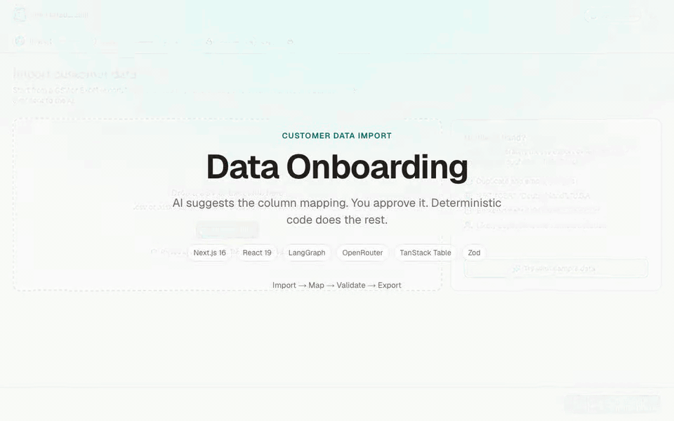
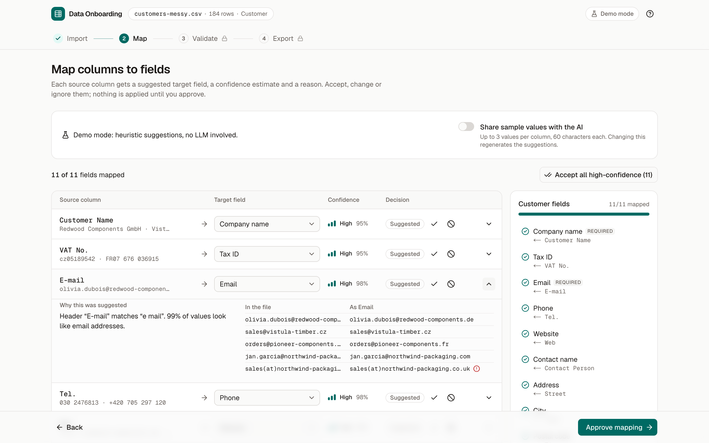
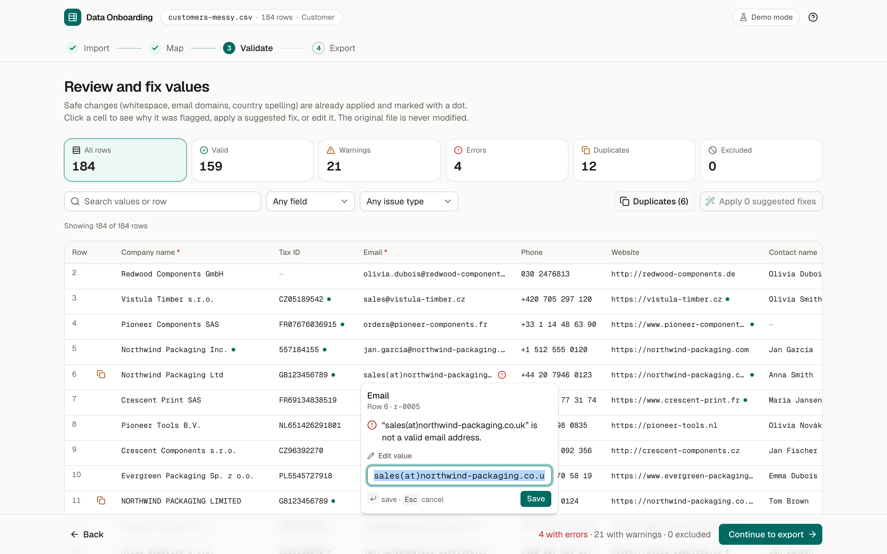
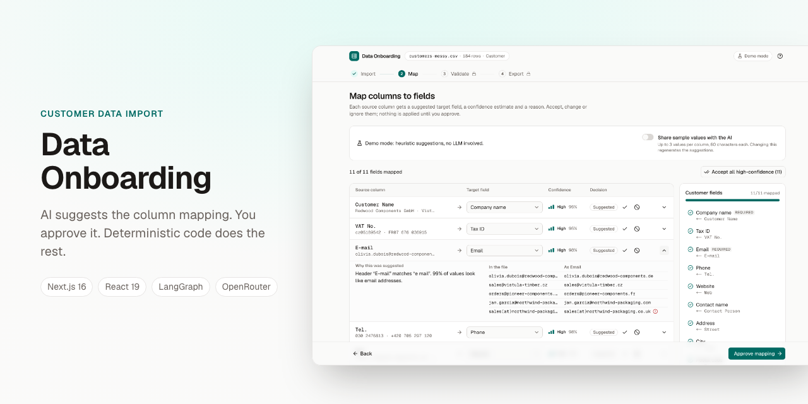

# Promo kit

Everything needed to show Data Onboarding off: a captioned walkthrough video, high-resolution stills, a social card and ready-to-post copy. All of it is generated from the real app by [`e2e/promo.spec.ts`](../../e2e/promo.spec.ts), so it can be regenerated after any UI change.

[](demo.mp4)

## Files

| File                 | What it is                                                                                         |
| -------------------- | -------------------------------------------------------------------------------------------------- |
| `demo.mp4`           | 49 s walkthrough, 1280×800, H.264, captioned, no audio. Plays on LinkedIn, X, Slack and in decks.  |
| `demo.gif`           | The same walkthrough at 1.25× speed and 960 px wide, for the README and anywhere video won't play. |
| `*-desktop.png`      | Stills at 1440×900, rendered at 2× (2880×1800).                                                    |
| `*-mobile.png`       | Stills at 390×844, rendered at 2× (780×1688).                                                      |
| `social-preview.png` | 1280×640 card for GitHub (Settings → General → Social preview) and link previews.                  |

The stills, in step order: `import`, `mapping`, `validation`, `validation-edit`, `export`.

| Mapping                                                            | Fixing a value                                                             |
| ------------------------------------------------------------------ | -------------------------------------------------------------------------- |
|  |  |



The recording runs in **demo mode**, so the suggestions come from heuristics and the header says “Demo mode”. That keeps every take identical and free. To record with a real model instead, see [Regenerating](#regenerating).

## Copy

**Name:** Data Onboarding

**Tagline:** AI suggests the column mapping. You approve it. Deterministic code does the rest.

**One-liner:** Turn a messy customer spreadsheet into a clean, validated import file in four steps, with an LLM helping where it is good at it and nowhere else.

**Short description (≈50 words):** Data Onboarding imports CSV and Excel customer lists, asks an LLM to suggest how each column maps to the target schema, and lets a person approve every decision. Validation, fixes, duplicate detection and a formula-safe CSV export are plain, tested code. The AI never sees raw values unless you opt in.

**What it does:**

- Parses CSV and XLSX in the browser; duplicate and empty headers are fixed and reported, nothing is uploaded.
- An LLM (LangGraph + OpenRouter) suggests a target field, a confidence and a reason for each column, from column profiles only. Sample values are opt-in.
- Human in the loop: accept, change or ignore each suggestion; the server re-checks the mapping before it is approved.
- Deterministic validation of every value: errors, warnings, duplicates, and one-click fixes for safe normalizations.
- Edit cells inline, exclude rows, and see why each value was flagged.
- Export a CSV that spreadsheets can't run as formulas, plus a JSON report of every decision, change and excluded row.
- Runs on Vercel without a database. 300+ unit tests, Playwright end-to-end tests with axe accessibility checks.

**Stack:** Next.js 16, React 19, TypeScript, LangGraph.js, OpenRouter, Zod, TanStack Table, Zustand, Tailwind CSS, shadcn/ui, Vitest, Playwright.

### Post (English)

> I built Data Onboarding: a tool that takes the messy customer spreadsheet everyone dreads and turns it into a clean import file.
>
> The split of work is the point. An LLM does the part it is good at: reading column names and profiles and suggesting that “Kontakt” is the email field, with a confidence and a reason. A person approves. Everything after that (validation, fixes, duplicate detection, a formula-safe CSV export and a full audit report) is plain, deterministic code.
>
> The model never sees raw values unless you opt in. No database; it runs on Vercel.
>
> Next.js 16 · React 19 · LangGraph · OpenRouter · TanStack Table · Zod
>
> 50-second demo below.

### Post (Polski)

> Zbudowałem Data Onboarding: narzędzie, które bierze nieuporządkowany arkusz z klientami i zamienia go w czysty plik do importu.
>
> Najważniejszy jest podział pracy. LLM robi to, w czym jest dobry: czyta nazwy i profile kolumn i podpowiada, że „Kontakt” to pole e-mail, razem z pewnością i uzasadnieniem. Człowiek zatwierdza. Wszystko dalej (walidacja, poprawki, wykrywanie duplikatów, eksport CSV odporny na formuły i pełny raport audytowy) to zwykły, deterministyczny kod.
>
> Model nie widzi surowych wartości, chyba że na to pozwolisz. Bez bazy danych, działa na Vercelu.
>
> Next.js 16 · React 19 · LangGraph · OpenRouter · TanStack Table · Zod
>
> 50-sekundowe demo poniżej.

### Short post (X, Bluesky)

> Messy customer CSV in, clean import file out. An LLM suggests the column mapping, you approve it, deterministic code validates and exports. Raw values stay private by default. Next.js 16 + LangGraph + OpenRouter.

## Regenerating

```bash
pnpm promo                 # video, stills and social card, in demo mode
pnpm promo:encode          # demo.webm → demo.mp4 and demo.gif (needs ffmpeg)
```

`pnpm promo` builds the app and runs `e2e/promo.spec.ts` against it; it is skipped in the regular `pnpm e2e` run. The raw recording lands in `test-results/promo-video/` (git-ignored) and the encoder trims the blank frames before the intro.

To show a real model in the recording, put `OPENROUTER_API_KEY` (and optionally `OPENROUTER_MODEL`) in `.env` and run:

```bash
PROMO_LIVE=1 pnpm promo
```

That makes three suggestion requests (video, desktop stills, mobile stills). The run fails instead of recording if the model falls back to heuristics, so a live take never shows a fallback by accident.
